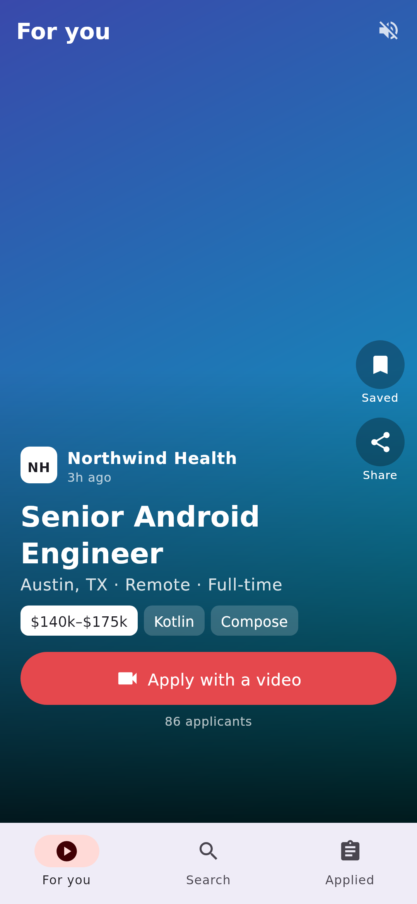
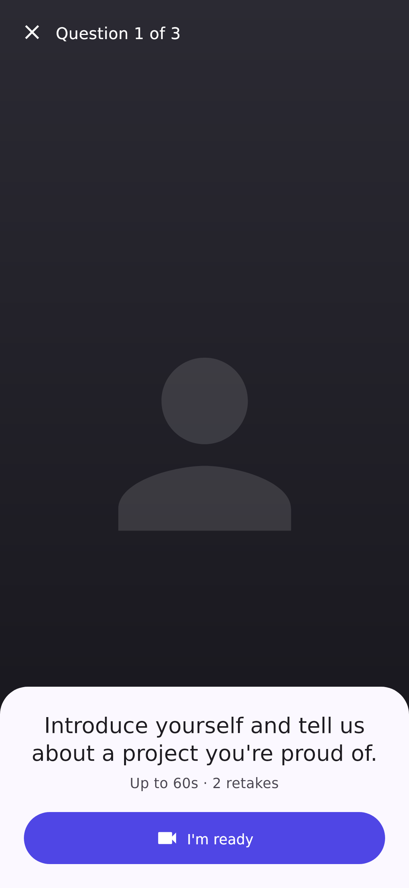
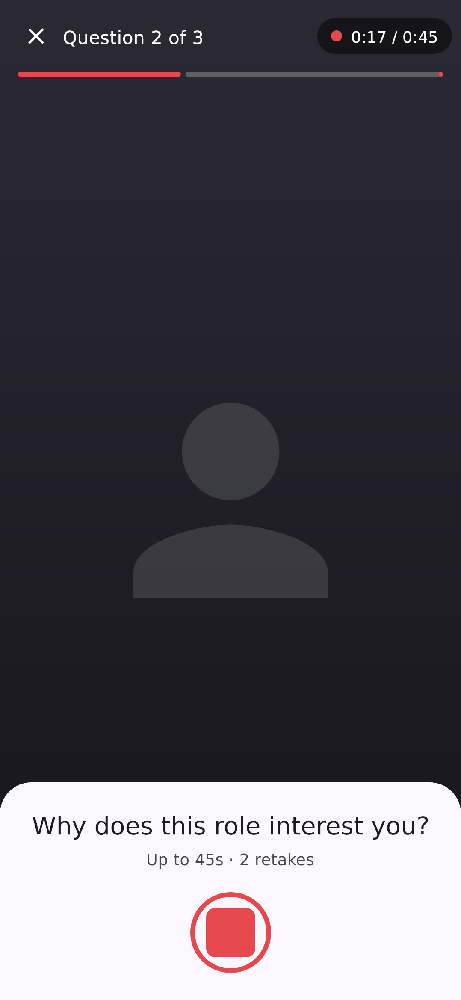
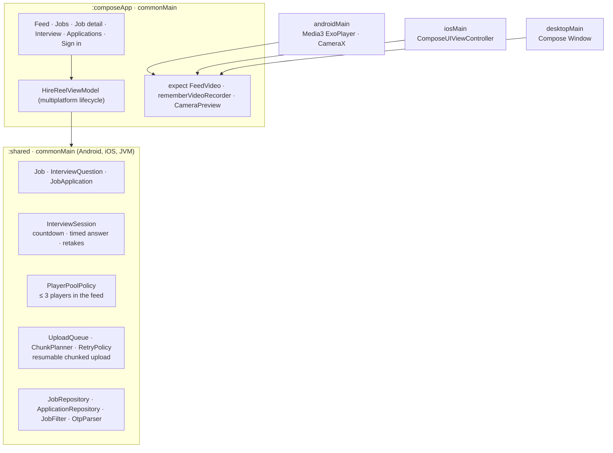

# HireReel · Kotlin Multiplatform

[](https://github.com/gayatripatel10091992/kmp-hirereel/actions/workflows/ci.yml)


The video-hiring app from [hirereel-video-jobs](https://github.com/gayatripatel10091992/hirereel-video-jobs), rebuilt with
**Kotlin Multiplatform**. Business logic and UI are written once and run on **Android, iOS and Desktop**. Only video
playback and the camera are platform code (`expect`/`actual`).

Candidates swipe through recruiter videos, record a timed one-way video interview with retakes, and submit.
Answers upload in resumable chunks with retry and backoff.

> Portfolio project, modelled on the kind of hiring app I built at Siyana. Original code; companies are fictional,
> and the feed clips are Google's public sample videos.

## Screenshots

The shared Compose UI is rendered headlessly on the JVM (Skia) at phone size, and CI commits the images on every push.
Video and camera surfaces are platform views, so the poster frames show instead.

| Sign in | Video feed | Search | Filters (dark) | Job detail |
|---|---|---|---|---|
|  |  |  |  |  |

| Interview: ready | Recording | Review & retake | All answers | Uploads |
|---|---|---|---|---|
|  |  |  |  |  |

## What's shared and what's native



| Platform | Entry point | Video / camera |
|---|---|---|
| Android | `MainActivity` | Media3 ExoPlayer (muted, looping, short buffers) and CameraX front-camera recording at SD |
| iOS | `MainViewController()` for the Xcode host app | Poster frames and a simulated recorder (AVPlayer and AVFoundation are the native drop-ins) |
| Desktop | `main.kt` (`./gradlew :composeApp:run`) | Poster frames and a simulated recorder |

## Tests

- **`:shared` commonTest** (runs on the JVM, Android unit tests and the iOS simulator): pool policy, interview flow and
  retake limits, chunking and backoff, filters, formatting, OTP parsing, and `UploadQueue` with virtual time (success,
  retry on 503, stop on 413).
- **Screenshots**: `ScreenshotTest` renders every screen with `ImageComposeScene`.
- **CI**: shared tests plus the Android APK, desktop distributable and screenshots on Ubuntu. `ios.yml` runs the shared
  tests on the iOS simulator and links the iOS framework on macOS.

## Build

```bash
./gradlew :shared:desktopTest           # shared logic on the JVM
./gradlew :composeApp:assembleDebug     # Android APK
./gradlew :composeApp:run               # Desktop app
./gradlew :composeApp:desktopTest       # screenshots → composeApp/build/screenshots
./gradlew :composeApp:linkDebugFrameworkIosSimulatorArm64   # iOS framework (macOS)
```

## License

MIT
